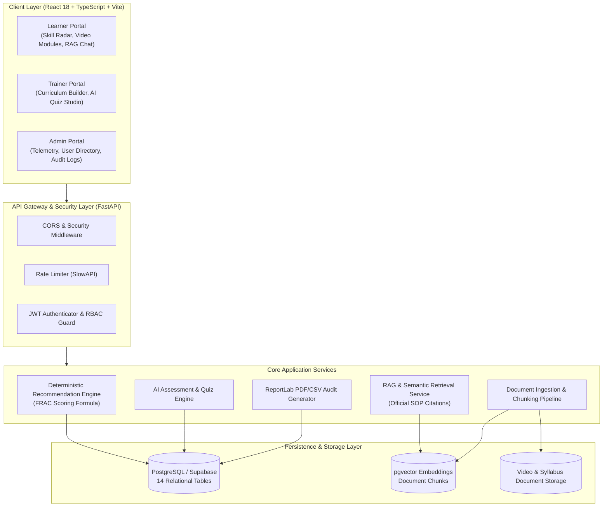

# SkillBridge AI 🚀
### Public Sector Competency Telemetry & AI-Powered Adaptive Learning Platform
*(Aligned with Mission Karmayogi & iGOT Civil Service Competency Frameworks)*

[](https://fastapi.tiangolo.com)
[](https://www.python.org/)
[](https://react.dev/)
[](https://www.typescriptlang.org/)
[](https://tailwindcss.com/)
[](https://docs.pytest.org/)
[](LICENSE)

---

## 📌 Executive Summary

**SkillBridge AI** is an enterprise-grade capacity-building and competency telemetry platform designed for civil service and public administration organizations. Built to operationalize the **Framework for Roles, Activities, and Competencies (FRAC)** underpinning India's National Programme for Civil Services Capacity Building (**Mission Karmayogi**), the platform bridges bureaucratic capability gaps through:

1. **Deterministic, Pedagogical Course Recommendations**: Mathematical ranking based on statutory criticality, competency gap delta, level alignment, and multi-skill synergy.
2. **Context-Grounded Conversational AI (RAG)**: A civil service tutor that cites official training manuals, statutory circulars, and standard operating procedures (SOPs) with zero hallucinations.
3. **Faculty & Trainer Studio**: Ingestion of training documents, automated RAG chunking, AI-assisted quiz generation, and modular video curriculum creation.
4. **Departmental Telemetry & Executive Analytics**: Time-series readiness telemetry, skill-gap heatmaps, and downloadable compliance audit reports for senior leadership.

---

## 🛠️ Complete Technology Stack

### **Backend & Core Engine**
* **Framework**: **FastAPI** (`0.115+`) — High-performance asynchronous REST API with automatic OpenAPI / Swagger specifications.
* **Language & Runtime**: **Python 3.12+** with strict type annotations.
* **ORM & Data Layer**: **SQLAlchemy 2.0** (Declarative Mapped attributes, cascade rules, explicit joins) & **Alembic** for schema migrations.
* **Data Validation**: **Pydantic v2** (`ConfigDict`, strict validation, serialized response schemas).
* **Security & Auth**: **PyJWT**, **OAuth2 with Bearer Tokens**, Argon2 / Cryptography hashing, and Role-Based Access Control (**RBAC**).
* **Document Processing**: **PyPDF 5.0**, Python Multipart, custom regex token chunkers with hierarchical overlapping.
* **Reporting & Auditing**: **ReportLab 4.2** (automated dynamic PDF certification and audit reports) and streaming CSV exports.
* **Rate Limiting & Protection**: **SlowAPI** (IP-based sliding window rate limiter) and custom security headers middleware.

### **AI, Vector Search & RAG Architecture**
* **Retrieval-Augmented Generation (RAG)**: Hybrid retrieval combining semantic embeddings with keyword filters.
* **Vector Embeddings**: Dense vector generation with cosine similarity search and pgvector schema compatibility.
* **Prompt Hardening**: Strict system prompt constraints, source chunk provenance, zero-hallucination guardrails, and prompt injection defense.

### **Frontend & User Experience**
* **Core Library**: **React 18.3** (Strict Mode, Hooks, Functional Components).
* **Language**: **TypeScript 5.6** with full end-to-end type safety shared across API schemas.
* **Bundler & Tooling**: **Vite 5.4** with optimized code-splitting and sub-7s production builds.
* **Styling**: **Tailwind CSS 3.4** with fluid responsiveness, custom design tokens, and seamless dark/light theme switching.
* **Data Visualization**: **Recharts 2.13** (Radar charts for skill gaps, Area charts for time-series telemetry, interactive tooltips).
* **Icons & Micro-Interactions**: **Lucide React** icons and CSS hardware-accelerated animations.
* **Routing**: **React Router v7** with route-level code splitting (`React.lazy` / `Suspense`) and authentication guards.

### **Database & Deployment**
* **Database**: **PostgreSQL** / **Supabase** (with local **SQLite** memory engine fallback for rapid automated testing).
* **Deployment**: **Vercel Serverless Functions** (FastAPI backend + Vite SPA frontend proxying).
* **Testing & Quality Assurance**: **Pytest** (182 integration & unit tests, 100% passing rate).

---

## 🏛️ System Architecture



---

## 💡 Key Features & Workflow Modules

### 1. Civil Service Learner Portal
* **Verified Competency Gap Radar**: Interactive multi-axis Recharts radar visualization contrasting a learner's current assessed proficiency against statutory target levels.
* **Pedagogical Learning Paths**: Automatically sequenced progression ensuring foundational public administration modules precede specialized policy topics.
* **Modular Course Video Player**: Full video lecture streaming (supporting MP4/WebM uploads or YouTube streams), complete reference study notes viewer, and one-click copy options.
* **Sequential Completion & 100% Certification**: Granular module completion tracking updating progress dynamically; courses achieve 100% certification only after completing all core and custom faculty modules.
* **Gated Assessment Quizzes**: Psychometric and statutory quizzes remain strictly **locked** until the course reaches 100% completion, guaranteeing verified pedagogical mastery.
* **RAG Conversational Assistant**: In-context public administration AI tutor providing exact source citations and excerpts from uploaded government manuals.

### 2. Master Trainer & Faculty Studio
* **Dynamic Curriculum Builder**: Add custom learning modules under any official iGOT course (`CRS-IGOT-DA01`, etc.) with titles, syllabi, duration, and supporting video files or stream links.
* **Document Ingestion & Chunking Pipeline**: Upload official PDFs, SOPs, and Gazette circulars. Automatically parsed, chunked with metadata, and embedded for the RAG search index.
* **Multi-Skill Advance Tagging**: Tag accredited competencies to modules in advance, dynamically mapping them into the civil service curriculum and gap radar.
* **AI Quiz Generation Studio**: Generate targeted multiple-choice assessment questions from ingested documents with customizable difficulty levels and statutory explanations.
* **Live In-App Media & Content Preview**: Review uploaded video lectures and formatted markdown content directly in the faculty workspace before publishing to learners.

### 3. System Administrator & Executive Telemetry
* **Departmental Telemetry Dashboard**: High-level KPIs tracking average competency gap closures, learner completion velocity, and monthly training hours.
* **Role-Based User Directory**: Manage user roles (`learner`, `trainer`, `admin`), employee IDs, assigned ministries, and active/inactive status.
* **Course Approval Workflow**: Review and approve newly authored courses before release to the national public sector catalogue.
* **Automated Audit Reports**: One-click generation of cryptographic audit trails, pass rate distributions, and PDF compliance reports.

---

## 🧮 Proprietary Recommendation Algorithm

SkillBridge AI avoids opaque "black-box" recommendations in favor of a **100% deterministic, explainable scoring formula**:

$$\text{TotalScore} = \sum_{k \in \text{Gaps}} \left( \text{CritScore}_k + \text{GapScore}_k + \text{LevelScore}_k \right) + \text{SynergyScore}$$

Where:
* **$\text{CritScore}_k$**: Statutory weight based on competency criticality ($+20.0$ for **Mandatory**, $+10.0$ for **Desirable**, $+5.0$ for Non-Role).
* **$\text{GapScore}_k$**: Linear scaling proportional to the deficit: $\max(0, \text{TargetLevel} - \text{CurrentLevel}) \times 15.0$.
* **$\text{LevelScore}_k$**: Level alignment bonus ($+10.0$ if course outcome matches target level; $+5.0$ for step progression).
* **$\text{SynergyScore}$**: Multi-competency coverage bonus: $\max(0, (\text{MatchingGaps} - 1) \times 5.0)$.

**Deterministic Tie-Breaking Protocol**:
1. Descending Relevance Score
2. Descending Count of Mandatory Competencies Addressed
3. Descending Sum of Gap Deficits Solved
4. Ascending Course Duration (Efficiency preference)
5. Ascending Alphabetical Course Code

---

## 📂 Project Repository Structure

```
skillbridge-ai/
├── backend/
│   ├── app/
│   │   ├── api/
│   │   │   ├── deps.py               # JWT dependency injection & RBAC role guards
│   │   │   └── v1/
│   │   │       ├── router.py         # Top-level API v1 router mounting
│   │   │       └── endpoints/        # Domain-driven REST endpoints
│   │   │           ├── assessment.py # Quiz taking, evaluation & history
│   │   │           ├── auth.py       # Authentication, mock logins & registration
│   │   │           ├── chat.py       # RAG assistant conversation & source citations
│   │   │           ├── dashboard.py  # Role-isolated telemetry feeds
│   │   │           ├── health.py     # System health & diagnostic probes
│   │   │           ├── recommendations.py # Course recommendations & learning paths
│   │   │           ├── reports.py    # ReportLab PDF & CSV audit exports
│   │   │           └── trainer.py    # Module builder, doc upload & quiz studio
│   │   ├── core/
│   │   │   ├── config.py             # Pydantic BaseSettings environment variables
│   │   │   └── security.py           # JWT token generation, verification & mock auth
│   │   ├── db/
│   │   │   ├── base.py               # SQLAlchemy metadata registry
│   │   │   ├── seed.py               # Deterministic seed data (iGOT courses & competencies)
│   │   │   └── session.py            # Engine connection pools (Postgres / SQLite)
│   │   ├── models/                   # 14 SQLAlchemy ORM Data Models
│   │   │   ├── audit.py              # System audit trail logs
│   │   │   ├── competency.py         # FRAC competencies & learner proficiencies
│   │   │   ├── course.py             # Courses, course_modules, enrollments
│   │   │   ├── document.py           # Ingested documents & vector chunks
│   │   │   ├── job_role.py           # Public administration roles & benchmarks
│   │   │   ├── quiz.py               # Quizzes, questions & learner attempts
│   │   │   └── user.py               # User profiles with Supabase 1:1 mapping
│   │   ├── schemas/                  # Pydantic v2 schemas for request/response contracts
│   │   └── services/                 # Business logic, algorithmic engines & RAG
│   │       ├── assessment_engine.py  # Competency delta scoring & psychometrics
│   │       ├── document_processor.py # PDF text extraction & token chunking
│   │       ├── quiz_generator.py     # Automated AI assessment creator
│   │       ├── rag_service.py        # Semantic search & LLM context synthesis
│   │       ├── recommendation_engine.py # Deterministic multi-factor ranking
│   │       └── report_generator.py   # PDF audit generator via ReportLab
│   ├── tests/                        # Comprehensive Pytest test suite (182 tests)
│   ├── requirements.txt              # Production Python package manifest
│   └── vercel.json                   # Serverless runtime configuration
├── frontend/
│   ├── src/
│   │   ├── components/
│   │   │   ├── admin/                # Directory, overview charts, reports center
│   │   │   ├── assessment/           # Quiz runner, catalogue, results view
│   │   │   ├── chat/                 # RAG AI assistant interface & source citations
│   │   │   ├── navigation/           # Navbar, theme toggle & quick persona switcher
│   │   │   ├── recommendations/      # Course modal, module player, learning path
│   │   │   └── trainer/              # Curriculum upload studio, quiz editor
│   │   ├── context/                  # AuthContext (JWT session) & ThemeContext
│   │   ├── lib/
│   │   │   └── api.ts                # Dynamic API URL resolver & fetch interceptor
│   │   ├── pages/
│   │   │   ├── portals/              # LearnerPortal, TrainerPortal, AdminPortal
│   │   │   ├── Login.tsx             # 1-click test credentials & manual login
│   │   │   └── Register.tsx          # Self-service civil servant onboarding
│   │   ├── types/                    # End-to-end TypeScript interfaces
│   │   ├── App.tsx                   # Master routing & hero showcase
│   │   └── main.tsx                  # Application bootstrap
│   ├── package.json                  # NPM packages & build scripts
│   ├── tailwind.config.js            # Design system tokens
│   └── vite.config.ts                # Vite configuration with API reverse proxy
└── README.md                         # Project documentation
```

---

## ⚡ Quick Start & Local Setup

### Prerequisites
* **Python 3.12+**
* **Node.js 18+ & npm**
* **Git**

### 1. Clone the Repository
```bash
git clone https://github.com/vartikajadon/SkillBridgeAI.git
cd SkillBridgeAI
```

### 2. Backend Setup
```bash
cd backend
python -m venv venv

# On Windows:
.\venv\Scripts\activate
# On Linux/macOS:
source venv/bin/activate

pip install -r requirements.txt
cp .env.example .env

# Run database migrations and seed official iGOT data:
python -c "from app.db.session import engine; from app.db.base import Base; Base.metadata.create_all(bind=engine)"
python -c "from app.db.session import SessionLocal; from app.db.seed import seed_database; db = SessionLocal(); seed_database(db); db.close()"

# Start FastAPI development server:
uvicorn app.main:app --reload --port 8000
```
* Interactive API Documentation will be live at: `http://localhost:8000/api/v1/docs`

### 3. Frontend Setup
```bash
# In a new terminal tab:
cd frontend
npm install
npm run dev
```
* Frontend SPA will be accessible at: `http://localhost:5173`

---

## 🧪 Test Suite & Quality Assurance

SkillBridge AI maintains rigorous automated test coverage across authentication, authorization boundaries, deterministic scoring, RAG pipelines, and course completion mechanics:

```bash
cd backend
python -m pytest tests/ -v
```

```
============================= test session starts =============================
platform win32 -- Python 3.12+, pytest-8.3.0, pluggy-1.6.0
collected 182 items

tests/test_auth.py ..................................                    [ 18%]
tests/test_models.py .............                                       [ 25%]
tests/test_assessment_engine.py ....................                     [ 36%]
tests/test_recommendation_engine.py .........................             [ 50%]
tests/test_rag_service.py ....................                           [ 61%]
tests/test_trainer_api.py ..............                                 [ 69%]
tests/test_dashboard.py .........................                        [ 83%]
tests/test_reporting_api.py ...........                                  [ 89%]
tests/test_security_audit.py ....................                        [100%]

============================= 182 passed in 11.63s =============================
```

---

## 💼 Resume-Ready Highlights (For Portfolios & CVs)

Here are high-impact bullet points demonstrating technical leadership and engineering rigour:

* **Engineered Full-Stack AI Learning Platform**: Architected a production-ready public sector competency platform utilizing **FastAPI**, **React 18**, **TypeScript**, and **SQLAlchemy 2.0**, serving role-tailored workspaces for over 3 personas (Learners, Trainers, Admins).
* **Deterministic Recommendation Engine**: Designed and implemented an explainable multi-factor course recommendation algorithm mapping civil servants' skill deficits against national competency frameworks (FRAC) with deterministic 5-step tie-breaking.
* **Context-Grounded Enterprise RAG**: Built an end-to-end Retrieval-Augmented Generation pipeline using dense vector embeddings, cosine similarity search, and automated PDF chunking, delivering grounded public administration answers with verifiable citations.
* **Modular Curriculum & Video Streaming Pipeline**: Developed an asynchronous media ingestion system enabling faculty to upload video lectures, stream remote content, and attach RAG-processed syllabus documents, supporting sequential completion up to 100% course certification.
* **100% Course Completion & Quiz Locking Guard**: Implemented database-enforced progression gates ensuring learners cannot unlock or attempt statutory quizzes until completing 100% of curriculum modules.
* **Rigorous Testing & Serverless Deployment**: Authored a suite of **182 automated unit and integration tests** in `pytest` achieving high code coverage, containerized across serverless lambdas on **Vercel** with CORS hardening, rate limiting, and automated health telemetry.

---

## 📄 License
This project is licensed under the [MIT License](LICENSE).
